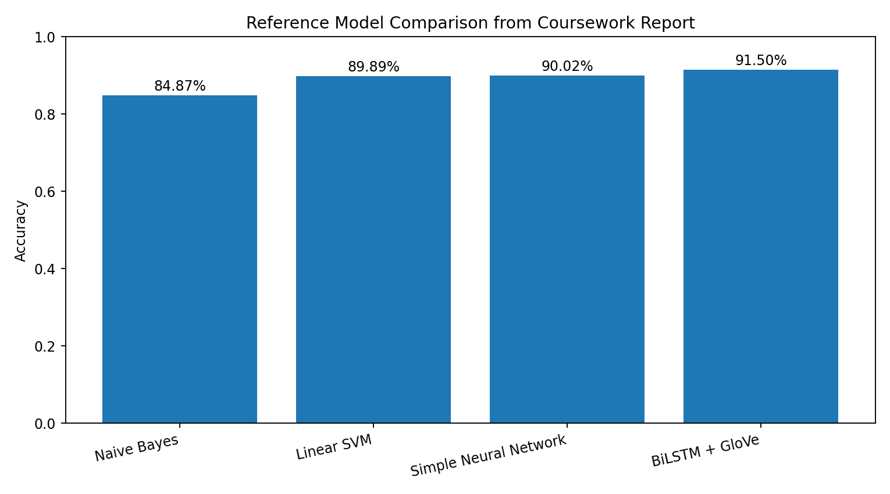

# NLP Emotion Recognition from Social Media Text

A comparative Natural Language Processing project for **six-class emotion recognition** on a large social-media dataset.

The project compares classical statistical NLP methods with neural architectures:

- Multinomial Naive Bayes + TF-IDF
- Linear Support Vector Machine + TF-IDF
- Feed-Forward Neural Network
- Bi-Directional LSTM with pre-trained GloVe embeddings

The coursework used **416,809 English-language text samples** labelled as:

- Sadness
- Joy
- Love
- Anger
- Fear
- Surprise

## Project highlights

- End-to-end text preprocessing pipeline for noisy social-media data
- HTML entity decoding and lowercasing
- Contraction expansion
- URL, user mention, hashtag, digit and punctuation removal
- Repeated-character normalization
- NLTK tokenization, stopword removal and WordNet lemmatization
- Stratified 80/20 train-test split
- TF-IDF feature extraction for statistical models
- TensorFlow text vectorization and trainable embeddings
- Pre-trained **GloVe 6B 100-dimensional** word embeddings
- Multi-class classification with four model families
- Accuracy, precision, recall, F1-score and confusion-matrix analysis
- Training-history, generalization-gap and confidence-analysis visualizations

## Reference results from the coursework report

| Model | Accuracy |
|---|---:|
| Multinomial Naive Bayes | 84.87% |
| Linear SVM | 89.89% |
| Simple Neural Network | 90.02% |
| Bi-Directional LSTM + GloVe | **91.50%** |

These values are transcribed from the final comparison figure in the submitted project report. Results can vary slightly when the code is rerun because of environment, dependency and training differences.



## Dataset

The project uses the **Twitter Emotion Dataset / Emotions Dataset** referenced in the coursework report.

The report records:

- **416,809** total text samples
- six emotion classes
- an imbalanced class distribution
- an 80/20 stratified split

The dataset itself is **not committed to this repository**.

See [`data/README.md`](data/README.md) for setup instructions.

## Preprocessing pipeline

The final preprocessing function documented in the project performs the following sequence:

1. Decode HTML entities
2. Convert text to lowercase
3. Expand common contractions
4. Remove URLs
5. Remove user mentions and hashtag markers
6. Remove digits
7. Normalize elongated character sequences
8. Remove punctuation
9. Tokenize with NLTK
10. Remove English stopwords
11. Lemmatize with `WordNetLemmatizer`

This pipeline was designed to reduce social-media noise while preserving emotion-bearing language.

## Models

### 1. Multinomial Naive Bayes

A scikit-learn pipeline using:

- `TfidfVectorizer(max_features=5000)`
- `MultinomialNB()`

This serves as the lightweight statistical baseline.

### 2. Linear SVM

A second TF-IDF pipeline using:

- `TfidfVectorizer(max_features=5000)`
- `LinearSVC(dual=False, random_state=42, max_iter=10000)`

This provides a stronger classical text-classification benchmark.

### 3. Feed-Forward Neural Network

The documented TensorFlow/Keras architecture is:

- `TextVectorization(max_tokens=10000, output_sequence_length=50)`
- `Embedding(input_dim=10000, output_dim=64)`
- `GlobalAveragePooling1D`
- `Dense(24, activation="relu")`
- `Dropout(0.5)`
- `Dense(6, activation="softmax")`

Training configuration:

- Adam optimiser
- categorical cross-entropy
- batch size 32
- 15 epochs

### 4. Bi-Directional LSTM + GloVe

The strongest model in the coursework uses:

- the same text vectorizer
- frozen `glove.6B.100d` embeddings
- `Bidirectional(LSTM(64))`
- `Dense(64, activation="relu")`
- `Dropout(0.5)`
- `Dense(6, activation="softmax")`

Training configuration:

- Adam optimiser
- categorical cross-entropy
- batch size 32
- 10 epochs

## Repository structure

```text
nlp-emotion-recognition/
├── README.md
├── requirements.txt
├── .gitignore
├── run_experiment.py
├── src/
│   ├── __init__.py
│   ├── config.py
│   ├── preprocessing.py
│   ├── models.py
│   └── evaluation.py
├── data/
│   └── README.md
├── results/
│   ├── README.md
│   ├── reference_metrics.csv
│   └── reference_model_comparison.png
├── notebooks/
│   └── README.md
└── docs/
    └── original_coursework_report.pdf
```

## Setup

Python 3.11 is recommended.

```bash
python3 -m venv .venv
source .venv/bin/activate
pip install -r requirements.txt
```

Download the required NLTK resources:

```bash
python -c "import nltk; [nltk.download(x) for x in ['punkt','stopwords','wordnet','omw-1.4','punkt_tab']]"
```

Place the dataset at:

```text
data/emotions.csv
```

The expected columns are:

```text
text
label
```

with labels `0` through `5`.

## Run the experiment

To train the Naive Bayes, SVM and simple neural-network models:

```bash
python run_experiment.py --data data/emotions.csv --skip-glove
```

To also train the GloVe Bi-LSTM:

```bash
python run_experiment.py --data data/emotions.csv
```

If `glove.6B.100d.txt` is not already available, the script can download the GloVe 6B archive used in the original coursework workflow.

## Outputs

Generated outputs are written to `results/generated/` and can include:

- classification reports
- confusion matrices
- model-comparison metrics
- model-comparison bar chart
- training-history plots

Generated model weights and large embedding/data files are excluded from Git.

## Reproducibility note

This repository is a **portfolio refactor reconstructed from the code appendix of the coursework PDF** supplied for this repository build. The original notebook file was not included in the supplied materials, so the appendix code has been reorganized into reusable Python modules without adding new model families.

The coursework appendix uses the held-out test split as `validation_data` during neural-network training. The refactor preserves that documented experimental workflow so that the repository matches the submitted report rather than silently changing the methodology.

## Limitations recorded in the project

The report identifies several limitations and future directions:

- static GloVe embeddings do not provide contextual representations
- sarcasm and irony remain difficult to classify
- minority classes, especially Surprise, remain harder to model
- transformer-based models such as BERT or RoBERTa could be explored in future work
- more extensive hyperparameter tuning could be added

## Skills demonstrated

**NLP:** text cleaning, tokenization, lemmatization, TF-IDF, embeddings, emotion classification  
**Machine Learning:** Naive Bayes, Linear SVM, model comparison, confusion matrices, F1 analysis  
**Deep Learning:** TensorFlow/Keras, embeddings, feed-forward networks, Bi-LSTM, dropout  
**Data Science:** pandas, NumPy, EDA, stratified splitting, class-imbalance analysis, visualization  
**Data Preprocessing:** normalization, noise removal, vocabulary reduction, linguistic preprocessing

## Author

**Zimmel Javed Virk**  
BSc Computer Science — University of London
